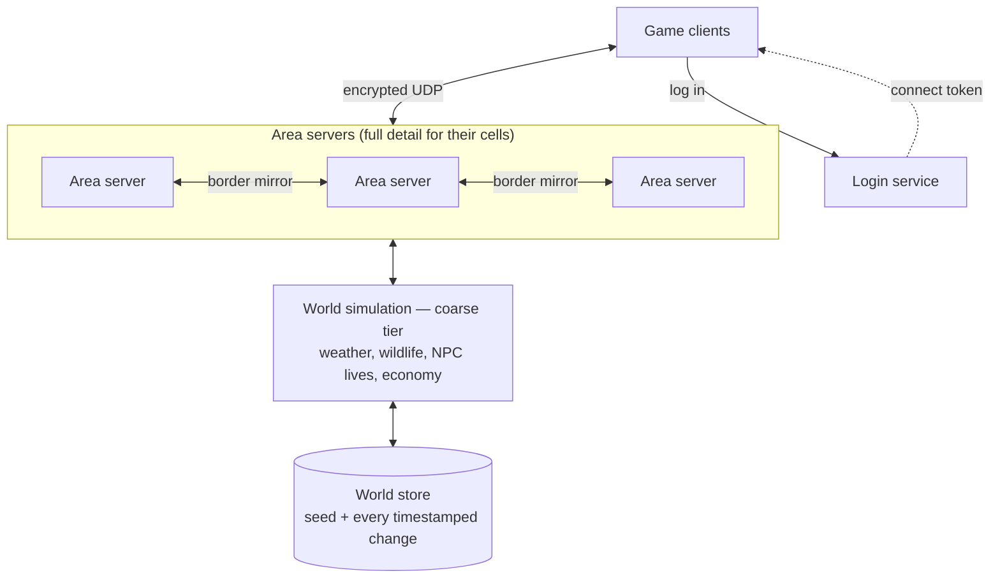

# HOG — MMORPG Design & Technical Plan

Oct 10, 2026 · @Aaron Nixon

## Vision and pillars

HOG is a 3D MMORPG game engine built on the premise of one seamless, round planet where players, NPCs and creatures share a living world that changes permanently. It is a game first: the simulation exists to create reasons to play, never chores.

- **One world.** A round planet with no zones, edges or loading screens. It looks Earth-sized, whatever its real scale.
- **A living world.** NPCs have jobs and lives, creatures have populations and life cycles, and quests come from real needs.
- **Permanent change.** Quarries run out, forests burn and regrow, and castles are built from real stone.
- **Everything is made by someone.** Players can craft anything, and even loot was made by someone in the world.
- **One magic system, many ways to cast.** Speech, gesture, rune, writing and memorization all drive the same underlying model.
- **Open-ended growth.** No level cap. Skills combine into new skills, and complexity rises with mastery while staying mostly invisible.
- **Deep characters.** Customization at Baldur's Gate 3 level or beyond, layered clothing, and crafter-designed looks.
- **Adults welcome, abuse not.** Per-server rulesets, strong moderation and community-run servers.

Not goals: photorealism, survival-sim chores (food and drink are for enjoyment), quest-giver theme parks, loot-table treadmills, or Android before desktop is solid.

Team and horizon: four people to start at hobby pace, likely open source, with a multi-year timeline and professional quality as the long-term bar.

## What already exists

No engine or framework, free or paid, covers more than a slice of this design. Every engine assumes a flat world, and none ships a server built for a simulated, seamless planet.

| Option | What it is | Verdict for HOG |
| --- | --- | --- |
| [Unreal Engine 5](https://conductatlas.com/platform/unreal-engine/unreal-engine-eula/royalty-payment-obligation-5-above-1m/) | Source-available, 5% royalty over $1M. Double-precision world coordinates | Best graphics and tools, but terrain and streaming are flat grids, multi-server support is [experimental](https://forums.unrealengine.com/t/2648232), and the editor is heavy |
| [Godot 4](https://docs.godotengine.org/en/stable/tutorials/physics/large_world_coordinates.html) | MIT, light editor, good Android support | Built-in networking [falls over at roughly 40 to 100 players](https://forum.godotengine.org/t/our-experience-building-an-mmo-tech-demo-with-godot-4-4-1-net-c/134348). Kept only as a reluctant client fallback |
| [O3DE](https://o3de.org/a-look-back-at-2025-and-what-to-look-forward-to-in-2026/) | Apache 2, Vulkan, Lua and Python | Heavy, macOS still experimental, no MMO server |
| [Flax](https://flaxengine.com/faq/) | C++ and C#, 4% royalty over $250k per quarter | Has [64-bit large worlds](https://docs.flaxengine.com/manual/editor/large-worlds), but basic networking |
| [Wicked Engine](https://turanszkij.itch.io/wicked-engine/devlog) | MIT, modern C++, Metal 4 on macOS since January 2026 | Clean code and strong rendering ideas; essentially a one-person project |
| [Ryzom Core](https://ryzom.dev) | Full source of a shipped MMO, AGPLv3 | Proven server design, but a dated renderer, a zoned world, and AGPL would bind our code |
| [SpacetimeDB](https://www.nuget.org/packages/SpacetimeDB.Runtime/2.8.0/License) / [BitCraft](https://bitcraftonline.com/news/bitcraft-open-sourcing-update) | Database-as-server; BitCraft is a single-world, player-crafted MMO | Restrictive license until it becomes AGPL in 2031. BitCraft's design is a strong reference |
| [Veloren](https://docs.veloren.net/veloren_rtsim/index.html) | Open-source voxel RPG in Rust | Its world simulation (rtsim) is the best reference for NPC lives, economy and wildlife |
| [Photon MMO backend](https://blog.photonengine.com/building-a-seamless-mmo-backend-across-machines/) | Seamless world split across machines, 64-bit coordinates (July 2026) | A prototype only, but it confirms our architecture is workable |
| Atavism, TrinityCore, WorldForge | Unity MMO kit, WoW emulator, dormant open MMO | Quest-giver designs, the opposite of HOG |

What we borrow:

- **Veloren rtsim:** a coarse simulation of the whole world that keeps NPCs, factions and wildlife alive where no player is.
- **Dual Universe and Star Citizen:** dynamic server areas, slower updates for distant players, and a connection layer that survives a server crash.
- **Star Wars Galaxies:** resources with random quality stats, crafting experimentation, and crafters selling parts to other crafters.
- **Enshrouded:** proof that editable voxel terrain can look good on Vulkan.
- **Roblox layered clothing:** the inner and outer cage method for stacking garments on any body.
- **Ultima Online's ecology (as a warning):** removed for server cost and because players never noticed it, not just because players killed everything.

## Core decision: our own engine and server

We build our own C++ engine and server, borrowing designs and permissively licensed libraries. Godot as the client stays a fallback we would rather not use.

Why:

1. **The server is the game.** Weather, wildlife, NPC lives and the economy run on the server across the whole planet. No engine provides that, so we write it either way.
2. **A round, seamless world fits better as our own core.** One way of dividing the sphere into cells can drive terrain detail, server areas, the weather grid and wildlife regions at once.
3. **It matches how we want to write C++.** No engine's codebase follows these rules.
4. **No license strings.** No royalties, and no restrictions on community-hosted servers or mods.

The cost is years of renderer and tools work. We accept that, and reduce it by building the server first behind a crude placeholder client, and by never building an Unreal-sized editor.

Code rules:

- C++23 now, adopting C++26's [hardened standard library](https://www.sandordargo.com/blog/2026/05/13/cpp26-library-hardening) as compilers ship it (Google measured about 0.3% overhead).
- Static dispatch by default (templates, variants, plain functions). Interfaces only where the concrete type genuinely can't be known.
- No owning raw pointers. Entities are referenced by generational handles, not pointers. Raw pointers only at external library boundaries.
- Sanitizers in CI, and unit tests for every system, refactoring for testability where needed.
- Build in stubbed steps so every regression can be traced through the history.

## The world

The planet is sized from a target virtual population, starts small, and always looks Earth-sized. It is hand-authored where it matters and filled procedurally elsewhere, and it changes permanently.

### Size from population

Planet radius is a single setting. A prototype picks the value; we can enlarge later. The sizing rule:

```latex
\text{land} = \frac{\text{population}}{\text{settled density}} \times \text{wilderness factor} \qquad r = \sqrt{\frac{\text{land} / \text{land fraction}}{4\pi}}
```

Assumptions: about 30 people per km² of settled land, three times as much wilderness as settled land, and 70% ocean. Skyrim's map, about 37 km², is the yardstick.

| Virtual population | Land | Skyrims | Radius | Walk around the equator | True horizon at eye height |
| --- | --- | --- | --- | --- | --- |
| 500k | 50k km² | \~1,350 | \~115 km | \~145 h | \~640 m |
| 2M | 200k km² | \~5,400 | \~230 km | \~290 h | \~910 m |
| 10M | 1M km² | \~27,000 | \~515 km | \~650 h | \~1.4 km |

Every option has a horizon far shorter than Earth's \~4.8 km, so rendering always fakes Earth-like curvature (see Rendering). A world that changes permanently is never fully seen, which matters more than raw size.

The first playable area is a chain of 5 to 8 islands, 10 to 60 km² each and within sailing distance of each other, placed on the real planet so nothing is thrown away.

### Authored first, procedural where it helps

Not everything is generated. The world is built in four layers, each stored the same way, with higher layers winning:

1. **Procedural base.** Deterministic algorithms (noise, erosion, geology, climate, vegetation distribution) fill the planet. No AI involved.
2. **Authored layer.** Hand-made coastlines, landmarks, towns, dungeons, dragon lairs and story places, sculpted by us over the base.
3. **Simulation layer.** Changes the world makes itself: settlements growing, forests spreading or burning.
4. **Player layer.** Everything players build, dig, burn or claim.

Procedural generation here means hand-written algorithms, not generative AI. By default we use **no diffusion or other generative-AI content** in shipped assets. Whether it has any role (for example concept reference only) is an open question.

### Seed plus changes

An Earth-like planet can't be stored outright. The world is a seed plus a record of everything that changed; untouched land is regenerated on demand.

- The generator must produce identical results on every platform and compiler, so client and server see the same mountain. That means integer or fixed-point maths in generation, not ordinary floating point.
- Every change is timestamped and attributed, which also lets game masters roll back griefing precisely.

### Terrain, stone and forests

- **Terrain** is a height map on the sphere almost everywhere, with true voxel volumes only where needed: caves, mines, quarries, magic craters and dug ground. Enshrouded shows voxels can look good.
- **Geology** lays down rock layers and deposits (a granite outcrop, a limestone seam, clay along rivers). A quarry holds a real, finite volume, and extraction is a permanent change.
- **Forests** are tracked by the coarse simulation as amount and type of vegetation per cell. Fire spreads with wind, humidity and heat, and burnt land regrows in stages over months or years. Individual trees are stored only where players touched them.
- **Travel scale** makes the starting region plus frontier model natural: civilization begins in one place and the rest of the planet is there to explore and settle.

## Rendering and distance

The scene is drawn in four distance layers, ending in a dynamic panorama "skybox" that holds everything beyond about 300 km. Weather sets how far anyone can see at any moment.

| Layer | Distance | What is drawn |
| --- | --- | --- |
| Near | 0 to \~1 km | Full geometry and characters |
| Mid | \~1 to 20 km | Merged, simplified versions of whole areas (towns, forests) |
| Far | 20 to 300+ km | Low-detail terrain plus flat cut-out images of big things (castles, cities, giant trees) |
| Horizon | Beyond | Captured panorama, updated as the player moves |

Why the far layers must reach so far: the eye isn't the limit, air and curvature are. On an Earth-sized planet a 3,000 m peak stays visible from about 200 km. Haze, rain and fog cut that most of the time, which gives the renderer a free budget.

What keeps the panorama convincing:

- **Relit every frame.** It stores colour, surface direction and depth per pixel rather than a finished image, so sunrise and storms light it correctly.
- **Updated as you move.** Walking 1 km sideways shifts a peak 50 km away by about 1°. The panorama is re-captured a little each frame once you've moved far enough, and haze hides the seams between layers.
- **Distant events show.** The server sends a slow, low-detail summary of visible changes in distant areas (fire, smoke, a new tower), separate from the full updates about nearby things.

**Curvature is always faked.** The simulation runs on the true, smaller sphere, but rendering bends the world as if the planet were Earth-sized. High up (flying, mountain peaks) we blend toward the true curvature, where people expect to see it.

**Art target:** characters as appealing as Baldur's Gate 3 up close and clearly better than classic Warcraft, in a "nice but not photoreal" style. The renderer is Vulkan everywhere, with macOS via [KosmicKrisp](https://www.phoronix.com/news/KosmicKrisp-Vulkan-1.4-2026) (Vulkan 1.4 conformant on Apple Silicon) or MoltenVK. Skies use Hillaire's atmosphere model and [Nubis-style](https://www.guerrilla-games.com/read/nubis-authoring-real-time-volumetric-cloudscapes-with-the-decima-engine) volumetric clouds driven by the weather simulation.

## Characters and layered clothing

Characters can be customized without limit because all fitting work happens once, when a look changes, never per frame. Clothing is a stack of layers, each stretched over the one beneath.

### Body and baking

- The body is shaped by sliders, starting from [MPFB2](https://www.cgchannel.com/2025/03/check-out-open-source-blender-character-generation-plugin-mpfb-2)'s 1,170 morphs (its art assets are CC0; we don't use its GPL code).
- When a character appears or changes, the client bakes one unique mesh: sliders applied, garments fitted, lower-detail versions generated, and skin, makeup, tattoos and clothing combined into one texture. The result is cached on disk under a fingerprint of the appearance.
- On the network an appearance is a few hundred bytes of settings, sent once.

### Detail by distance

| Tier | What is drawn |
| --- | --- |
| Near | Full mesh, hair, facial animation, cloth physics on capes and robes |
| Mid | Reduced mesh, simplified hair, baked cloth sway, no facial animation |
| Far | Very low mesh, or animated flat images of the character |
| Beyond | Only giants and dragons |

Only the N characters biggest on screen get full quality, so a 300-player city costs about the same as a 30-player one.

### The clothing stack

Each garment has an inner "cage" (its fitted shape) and an outer cage (the surface the next layer sits on), the method [Roblox uses](https://create.roblox.com/docs/reference/engine/classes/WrapLayer).

| # | Layer | Behaviour |
| --- | --- | --- |
| 0 | Body | Shaped by sliders |
| 1 | Undergarments, tights | Soft and skin-tight. Tattoos and makeup are painted into the skin |
| 2 | Base clothing | Soft, stretches over what's beneath |
| 3 | Mid layer (tunic, padded jacket) | Soft, thicker |
| 4 | Outer clothing (coat, robe) | Soft, cloth physics up close |
| 5 | Armour | Semi-rigid (mail, leather) or rigid (plate) |
| 6 | Over layer (cape, cloak, tabard) | Cloth physics up close |
| 7 | Adornments (belts, pouches, jewellery) | Attached at fixed points on the layer below |

- **Plate doesn't stretch.** Plates follow particular bones, can resize per axis but never bend, and are shaped to slide past each other. Inverse kinematics and procedural pivots keep pauldrons and tassets looking right at any size.
- **Hidden parts aren't drawn.** Anything covered by an opaque outer layer is skipped, which kills poke-through and saves drawing work.
- **Testing:** fitting is pure geometry, so thousands of random bodies across the slider extremes can be dressed in every combination and checked for poke-through automatically.

### Armour fit

Every body produces a measurement profile (height, chest, waist, shoulders, arm and leg length), and every garment has a fit range. Soft clothing is forgiving, mail and leather moderate, plate tight. Outside the range you can't wear it.

This creates gameplay: made-to-measure commissions, refitting found armour as a skill, and ill-fitting loot as trade goods.

### Crafter-designed looks

Crafters fill in a garment template rather than modelling a mesh, so every design is guaranteed to fit.

- **Shape:** length, cut, fit, sleeves, collar and closures.
- **Look layers:** base material from the real crafting ingredients, dye channels, pattern fills, painted strokes and lines, decals, wear and dirt.
- **Strokes are stored as data** (path, width, colour, brush), not pixels, so a design is a few KB and sharp at any size.
- **Approval:** dyes, fills and patterns are free to use. Freehand strokes and decals show to their maker at once but only to others after approval (or right away on community servers with relaxed rules).
- **Known hard problem:** clothes fitting extreme bodies. Fit ranges and slider limits are how we keep it tractable.

## The living world

The world is simulated in two tiers: a cheap, coarse simulation runs everywhere all the time, and full detail exists only near players. This is the approach of Veloren's [rtsim](https://docs.veloren.net/veloren_rtsim/index.html), which simulates tens of thousands of NPCs in real time.

- **Coarse tier:** weather, wildlife populations, vegetation, NPC schedules and needs, settlements, trade and factions, simulated per cell across the planet.
- **Detailed tier:** actual creatures and NPCs with bodies, animation and physics, created from the coarse state when players come near and folded back into it when they leave.
- **The two stay consistent.** Killing a creature subtracts from its population; spawning draws from it.

### Weather

A coarse global model (temperature, pressure, humidity and wind per cell, with latitude bands and seasons from axial tilt) runs on the server. Clients render it as volumetric clouds, rain and fog. Weather feeds everything else: fire spread, crops, creature migration, visibility and magic.

### Ecology and succession

- Each species has a population per region, with food webs, carrying capacity and migration.
- Overpopulation spills into neighbouring regions and creates NPC requests to cull.
- Underpopulation makes a species rare and valuable.
- **When an apex creature dies, its niche opens.** A list of possible successors competes for it: another dragon moves in, something worse arrives, or the cave stays empty for a while. No fixed respawn timers.
- Lesson from [Ultima Online](https://www.raphkoster.com/?p=46439): its ecology was removed for server cost and because players never noticed it. The coarse tier solves cost; design must make effects visible and give populations room to recover.

### NPC lives and quests from need

- NPCs act on needs and goals: work, food, family, money, ambition. Planned behaviour comes from goal planning, not scripts.
- **Quests come from needs.** A smith short on ore asks for it, a farmer losing sheep asks for help with wolves, a leather worker chasing the best armour of her life wants a rare hide. The request is the quest.
- **Tiers of NPCs:** statistical populations per settlement; tens to hundreds of thousands of individuals with real lives; and any statistical NPC becomes a full individual the moment a player interacts with them, and stays one.
- Lesson from Oblivion's Radiant AI: free-acting NPCs murdered each other over items and had to be reined in. NPC behaviour needs limits.
- AI-generated dialogue (LLMs) is a possible later addition, weighed against running cost and moderation risk.

## Items, loot and crafting

There are no loot tables: every item in the world was made by someone. A drop can beat anything crafted today, as long as players can study it and eventually surpass it.

- **Every item has a maker.** NPC crafters, long-dead civilizations from the generated history, or a hoard a dragon gathered over centuries of simulated time. Goblins carry what goblins made or stole.
- **Drops are random but grounded.** An ancient master smith's blade can be extraordinary; there is no rule capping loot below crafting.
- **Items can be studied.** Each carries its history and hidden properties. Studying reveals material and technique, depending on skill; taking it apart reveals more but destroys it.
- **NPC master crafters** pursue life goals (the best leather armour ever made), and act as rivals, teachers and quest sources.
- **Anything can be crafted by players,** including the best items in the game. A single player on a server may make things better than anything we designed.

Crafting follows [Star Wars Galaxies](https://swgr.org/wiki/crafting):

- Resources have quality stats that vary by source, so a deposit can be excellent for one recipe and useless for another.
- Crafters experiment to push particular stats on an item.
- Crafters sell parts to other crafters, so specialization pays.
- Recipes grow more complex with skill (a top armour may take 16 steps). Quality has no hard cap, only diminishing returns.

Social layer:

- **Teaching.** Master crafters can teach other players.
- **Fame.** Renowned crafters become sought after, and game masters can feature a player's work in epic item quests.
- **Combination.** Crafting skills combine into new sub-skills and specializations, the same way all skills do.

## Magic and skills (early direction)

These two systems are only sketched so far and need their own design rounds.

### Magic

Every casting style feeds the same underlying spell structure: **gather** energy from a source in the world, **shape** it, **contain** it, then **release** it on a trigger.

- **Sources are part of the world:** heat, life, storms, ley lines, and perhaps the void. Weather and place change what's available.
- **Casting styles are just ways of entering a spell.** Speech, gesture, rune, writing and memorization trade off speed, reliability, silence, preparation and cost.
- **Behaviour emerges from the model.** A fireball held by weakening containment bursts when the energy inside overpowers it, so its timing is a property the caster can learn to control.
- **Player-designed spells are programs running on the server,** so each needs a hard cost cap and a sandbox.
- Prior art: Noita (composable spells), Magicka (combining elements), Ars Magica (action plus subject), Arx Fatalis (drawn runes), and [Asheron's Call](https://loresraat.org/wiki/Spell_Components), whose researchable formulas were later replaced by scrolls. Lesson: secrets get posted on a wiki, so discovery must survive being spoiled.

### Skills and character level

- No level cap. Each skill costs exponentially more to raise.
- Skills form a graph: as they grow, existing skills combine into new skills, sub-skills and specializations.
- **Character level is calculated from the total effort invested across all skills, not from how many skills there are.** 200 level-1 skills add up to very little. The exact formula is still open.
- Complexity grows with mastery but stays mostly invisible: the game should feel natural, not like a spreadsheet.

## Travel

There are many ways to travel, including fast travel, because it's a game. The signature option is napping on a wagon.

- **Options:** walking, mounts, ships, NPC caravans and wagons, player-run transport, player-made portals, and fast travel.
- **Wagon nap:** a time skip for one player. The server moves you to the destination while your screen fades. Other passengers choose for themselves whether to nap.
- **The stand-in rider:** a simplified, AI-driven copy of the napping character stays on the wagon, gets off at the stop and walks into the crowd before vanishing. If the real character is nearby, it walks away so the two never meet.
- **Caravans are real.** A wagon is an NPC caravan in the simulation; the caravan master's job is part of the economy, and a raided caravan is a story even if nappers skip it.
- **Player transport:** a player can run a taxi, wagon line or ferry. The driver declares a destination; passengers pay at boarding and the fare is released to the driver on arrival. Napping skips to the declared destination; if the driver changes course, the napper wakes at the last confirmed point.

## Combat, networking and servers

Combat is action-based, the server has the final say, and players never talk to each other directly. Each area of the world is run by its own server, with borders that move away from activity.



Area servers run full detail for their cells, mirror entities across borders, and fold detail back into the shared coarse simulation, which persists the world as a seed plus changes.

### Who decides what

| Who decides | What |
| --- | --- |
| Client proposes, server checks | Movement. Speed, collisions and plausibility are checked; anything wonky is reversed |
| Server only | Combat results, inventory, crafting, the economy |

- Clients predict their own movement. The server keeps a short history of positions so it can judge hits as each player saw them.
- About 30 updates per second where fighting happens, fewer elsewhere.
- Big battles degrade gracefully: slower updates for distant fighters, grouped projectiles.
- Magic fits the model: fireballs and fields are physical objects the server simulates.

### Connections

- **No peer-to-peer.** It would expose players' IP addresses to everyone nearby, fail behind many home routers, let peers lie to each other, and still not save the bandwidth that matters. Servers relay everything, including chat, emotes and voice.
- **One encrypted UDP connection, no TCP,** carrying three kinds of message: reliable and in order (chat, inventory, trades); reliable in any order (asset requests); unreliable, newest wins (movement and animation).
- **Proven encryption, our own game protocol on top.** Candidates: Valve's GameNetworkingSockets (BSD) or QUIC with its datagram extension.
- **Login hands out short-lived connect tokens** that game servers check, which stops spoofing and replay.

### Servers and bandwidth

Rough cost of sending state out:

- One player seeing 100 entities at 20 updates per second, about 12 compressed bytes each: 100 × 20 × 12 ≈ 24 KB/s, which is fine.
- Five thousand players: 5,000 × 24 KB/s ≈ 120 MB/s, about 1 Gbps. Hence splitting the world across machines.

How the load is kept down:

- Each player gets only what's near them, and only what changed, packed into as few bits as possible.
- Less important or more distant things update less often.
- Distant events travel in the slow, low-detail summary.
- Later, relay servers in front of the game servers handle the sending out.

Area servers mirror entities near their borders onto neighbours over the datacentre network, which is far faster than any client link. The hard cases are handing players over, fights that straddle a border, and crowds piling into one spot; borders that move away from activity address all three.

**Scaling path:** design for thousands of players, test with hundreds, start with four. The world-splitting logic exists from day one but runs inside one process; moving areas onto separate machines is a deployment step, not a rewrite.

## Moderation, griefing and server rulesets

Adults can be themselves; abuse gets caught by automatic moderation and handled by game masters. Each server declares its own ruleset.

- **Rulesets per server:** PvP is one server-wide setting (all PvE, or PvE plus PvP), and language and content rules vary by server. No game system may assume either PvP setting. Community-hosted servers set their own policy.
- **Chat:** a profanity filter on the player's side, on by default and controllable by the player; hate speech and harassment detection on the server using self-hosted classifiers; block, mute and report tools.
- **Behaviour automod** watches for high-level players killing low-level ones in streaks, repeated targeting of the same player, and camping the spot where players respawn.
- **Escalation:** flag, then restrict (for example, turn off the player's PvP), then a temporary ban, then human review, then a permanent ban. The first automatic steps stay mild because false positives drive players away.
- **Rollback:** every world change is timestamped and attributed, so game masters can undo one griefer's quarry-gutting or forest-burning without touching anything else. Server authority also gives a complete log for reviews.
- **Player-made images** (freehand strokes and decals on gear) go through approval before others see them.
- **Minors and the law:** age checks and the duties around minors (US children's privacy law, the UK Online Safety Act, the EU Digital Services Act) need a lawyer. Official servers being 18+ only is the simplest starting point.

## Tools, scripting and tech stack

The editor is a Qt desktop app, scripting is Squirrel, and everything else is built from permissively licensed libraries. The renderer never owns its window, so the same renderer runs inside the game (SDL3 window) and the editor (Qt window).

### Tools

- **Editor and GM tools:** Qt 6 Widgets, with our Vulkan viewport embedded. Docking panels, property grids and undo work natively on all three desktops and on older hardware.
- **In-engine debug overlays:** Dear ImGui, for frame times, network graphs and simulation inspectors. Not used for game UI.
- **Art:** Blender as the modelling tool, with export add-ons.
- **Live editing:** game masters and builders edit the running world on a dev server.
- No Unreal-sized editor; tools grow as the game needs them.

### Scripting

- **Squirrel 3.2** is the first-class language: C-style syntax, classes, real integers, and reference counting, so objects are freed predictably with no garbage-collector pauses mid-tick.
- It sits behind a scripting interface not tied to any one language, so others can be added later. WebAssembly (Wasmtime or WAMR) is the likely route for bring-your-own-language.
- **Sandboxing is mandatory** for anything running on a server: instruction and memory limits, added to the Squirrel VM ourselves.
- Trade-off accepted: Lua has a bigger ecosystem, faster runtimes (LuaJIT, Luau) and a built-in sandbox in Luau.

### Stack

| Area | Choice | Licence |
| --- | --- | --- |
| Language | C++23, C++26 hardening when available | — |
| Window and input | SDL3 | zlib |
| Graphics | Vulkan, volk, Vulkan Memory Allocator | MIT |
| macOS graphics | KosmicKrisp or MoltenVK | MIT / Apache 2 |
| Shaders | Slang | Open source, license to confirm |
| Physics | Jolt (double-precision mode) | MIT |
| Networking | GameNetworkingSockets or QUIC | BSD / MIT |
| Scripting | Squirrel 3.2 | MIT |
| Game UI | RmlUi | MIT |
| Editor UI | Qt 6 Widgets | LGPLv3, dynamically linked |
| Debug UI | Dear ImGui | MIT |
| Mesh processing | meshoptimizer | MIT |
| Character base | MPFB2 assets only | CC0 |
| Entity system | EnTT or flecs (undecided) | MIT |

## Licensing

We lean toward MIT for our own code, not yet decided. To keep that option open, nothing GPL or AGPL goes into the core.

| Option | Effect |
| --- | --- |
| MIT or Apache 2 | Anyone can use it, including closed forks |
| MPL 2.0 | Changes to our own files must be shared back |
| AGPL | Anyone who runs a server must share their changes |

- **Qt** is LGPLv3: fine as long as it is a separately loaded shared library, not compiled into our program.
- **MPFB2:** use the CC0 assets, never the GPL code.
- **Ryzom Core and SpacetimeDB** are off the table while we stay MIT-compatible.
- Art and content may need a different licence from the code; still open.

## Build order

The first milestone: **four of us walking around the starting islands on a round planet with live weather, connected to one server.** Each step below is usable and unit-tested before the next starts, built from stubs so every regression has a trail.

0. **Repo skeleton:** CMake, CI on Linux, Windows and macOS, a unit-test framework, sanitizers and the hardened standard library.
1. **Planet core library:** the cube-sphere cell system, double-precision coordinates and the deterministic generator. Pure maths, heavily tested.
2. **Headless server:** game loop, entity system, and the coarse weather and wildlife simulation, viewable through a debug UI.
3. **Placeholder client:** SDL3 and Vulkan drawing planet terrain, atmosphere and a free-fly camera, with faked curvature.
4. **One server, many clients:** walk the islands, receiving only nearby updates. *First milestone reached.*
5. **Several areas:** split the world dynamically and hand players over, still inside one process.
6. **Gameplay systems,** each a tested library with its own debug views: characters and clothing, skills, magic, crafting, NPC needs, ecology.

Android comes long after desktop is solid.

Phases, gates and task lists: [Roadmap](roadmap.md)

## Open questions

- [ ] Death penalty: what does dying cost?
- [ ] PvP setting for official servers.
- [ ] Virtual population target (a prototype decides the planet radius).
- [ ] Generative AI (diffusion): none at all, internal concept reference only, or something else?
- [ ] Magic system internals: energy sources, the spell structure, casting-style trade-offs.
- [ ] Skill graph and the formula that turns invested effort into character level.
- [ ] Crafting and economy details, including how NPC crafters compete.
- [ ] Art direction: a few reference games for "nice but not photoreal".
- [ ] Entity system library: EnTT or flecs.
- [ ] How to sandbox Squirrel (instruction and memory limits).
- [ ] Code licence (leaning MIT) and a separate licence for art and content.
- [ ] Legal review of age checks and minors before any public server.

## Sources

Links gathered during research in October 2026; figures are as reported there.

- [Veloren rtsim](https://docs.veloren.net/veloren_rtsim/index.html)
- [Photon: Building an MMO backend](https://blog.photonengine.com/building-a-seamless-mmo-backend-across-machines/)
- [BitCraft open-sourcing update](https://bitcraftonline.com/news/bitcraft-open-sourcing-update)
- [SpacetimeDB licence](https://www.nuget.org/packages/SpacetimeDB.Runtime/2.8.0/License)
- [Ryzom Core](https://ryzom.dev)
- [Unreal MultiServer Replication plugin](https://forums.unrealengine.com/t/2648232)
- [Godot MMO tech demo experience](https://forum.godotengine.org/t/our-experience-building-an-mmo-tech-demo-with-godot-4-4-1-net-c/134348)
- [Flax large worlds](https://docs.flaxengine.com/manual/editor/large-worlds)
- [KosmicKrisp Vulkan 1.4](https://www.phoronix.com/news/KosmicKrisp-Vulkan-1.4-2026)
- [C++26 library hardening](https://www.sandordargo.com/blog/2026/05/13/cpp26-library-hardening)
- [Nubis volumetric clouds](https://www.guerrilla-games.com/read/nubis-authoring-real-time-volumetric-cloudscapes-with-the-decima-engine)
- [Roblox WrapLayer](https://create.roblox.com/docs/reference/engine/classes/WrapLayer)
- [MPFB2](https://www.cgchannel.com/2025/03/check-out-open-source-blender-character-generation-plugin-mpfb-2)
- [Raph Koster on Ultima Online's ecology](https://www.raphkoster.com/?p=46439)
- [Star Wars Galaxies crafting](https://swgr.org/wiki/crafting)
- [Asheron's Call spell components](https://loresraat.org/wiki/Spell_Components)
- [Enshrouded world creation](https://enshrouded.com/news/creating-the-world-of-enshrouded)
- [Qt 6 licensing](https://doc.qt.io/qt-6/licensing.html)
