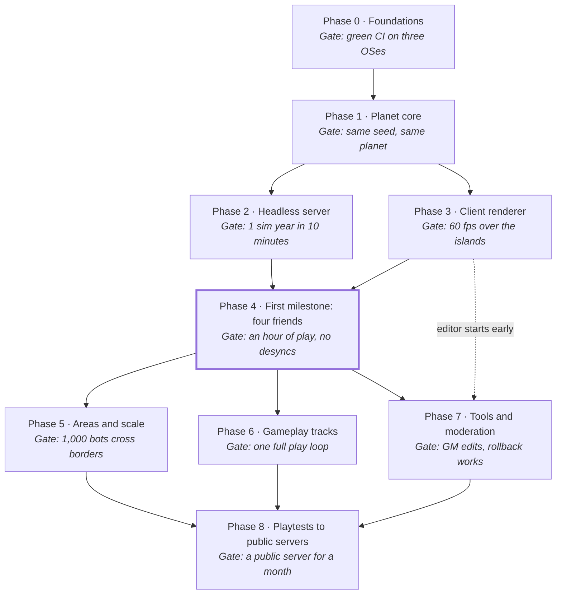

# Roadmap

Oct 10, 2026 · @Aaron Nixon

Start with Phase 0: a repo that builds and passes tests on Linux, Windows and macOS. Then build the planet library, whose first visible result is map images of the starting islands. Each phase ends at a gate the whole team can check. Near phases have detailed task lists; later ones stay coarse and get detail as we reach them.

## At a glance

Phases 0 and 1 are strictly in order. After that, server and client work split across the team until Phase 4. From there, gameplay, scale and tools run side by side.

## Decide first

Five choices block Phase 0. Each one can be settled in an evening. The rest of the open questions are due only when their phase starts.

| Decision | Options | Needed by | Leaning or outcome |
| --- | --- | --- | --- |
| Repo host | GitHub, GitLab, Codeberg | Phase 0 | **Decided:** GitHub |
| Code license | MIT, Apache-2.0, MPL-2.0 | Phase 0 | **Decided:** MIT |
| Dependency management | vcpkg manifest, CPM.cmake, git submodules | Phase 0 | **Decided:** CPM.cmake, pinned versions |
| Unit-test framework | doctest, Catch2, GoogleTest | Phase 0 | **Decided:** Catch2 v3 |
| Compilers | Clang, GCC, MSVC, clang-cl, AppleClang | Phase 0 | **Decided:** Clang with libc++ first; GCC, MSVC and AppleClang in CI |
| Generator maths | Integer hashing, fixed-point, strict IEEE floats | Phase 1 | **Decided ([#7](https://github.com/SuperFes/HOG/issues/7)):** integer and fixed-point; floats only after the deterministic step |
| Change-store backend | SQLite, custom append-only log | Phase 1 | **Decided ([#8](https://github.com/SuperFes/HOG/issues/8)):** SQLite behind an interface, swappable for production |
| Development planet size | 500k, 2M or 10M population tier | Phase 1 | **Decided ([#9](https://github.com/SuperFes/HOG/issues/9)):** 500k (115 km radius); the radius stays a parameter |
| Entity system | EnTT, flecs | Phase 2 | **Decided ([#32](https://github.com/SuperFes/HOG/issues/32)):** flecs |
| Minimum-spec hardware | e.g. GTX 1060, Intel Iris Xe, Apple M1 | Phase 3 | Pick one real machine one of us owns |
| macOS Vulkan layer | KosmicKrisp, MoltenVK | Phase 3 | Support both and test against each |
| Network library | GameNetworkingSockets, QUIC with datagrams | Phase 4 | Decide with a spike |
| Art direction | Three or four reference games | Phase 3 end | Open |
| Death penalty, PvP default | See the plan's open questions | Phase 6 | Open |
| Generative AI in content | None, internal concept reference only | Before any content production | None in shipped assets |
| Content and art license | CC BY 4.0, CC BY-SA 4.0, proprietary | Phase 6 | Open |
| Age checks and minors | Legal review | Phase 8 | Official servers 18+ to start |

## Phase 0 — Foundations

This phase builds the repo and the rules every later line of code follows. It has no game in it yet.

**Gate:** a clean clone builds and passes tests with one command on all three operating systems. CI runs sanitizers on every push.

**Repo and process**

- [x] Create the repo with a README, LICENSE, .gitignore and .editorconfig
- [x] Export the plan doc to `docs/plan.md` and this roadmap to `docs/roadmap.md`
- [x] CONTRIBUTING.md with the code rules from the plan (no raw owning pointers, static dispatch by default, tests for everything)
- [x] Commit style: short conventional commits; pull requests reviewed by one other person
- [x] Issue labels (phase, track, bug, spike, decision) and one milestone per phase
- [x] Turn the Phase 0 and Phase 1 lists below into issues

**Build**

- [x] CMake 3.28+ with presets: debug, release, asan+ubsan, tsan
- [x] Ninja generator everywhere; ccache or sccache
- [x] C++23, warnings as errors in CI, `-Wall -Wextra -Wpedantic` and the `/W4` equivalent
- [x] Hardened standard library on: `_GLIBCXX_ASSERTIONS` and `_LIBCPP_HARDENING_MODE`, plus the MSVC checked-iterator equivalent
- [x] Dependency manager set up with pinned versions
- [x] .clang-format and .clang-tidy committed; format check in CI

**Continuous integration**

- [x] Linux: GCC and Clang
- [x] Windows: MSVC
- [x] macOS: AppleClang on Apple Silicon
- [x] Sanitizer job (address, undefined) on Linux
- [x] Thread-sanitizer job (nightly is fine)
- [x] clang-tidy job on changed files
- [ ] Test results and timings shown in the pull request

**Core library (`hog_core`)**

- [x] Generational handle and slot map: the replacement for pointers between objects
- [x] Error type built on `std::expected`; no exceptions across module boundaries
- [x] Assertions that stay on in release builds for invariants
- [x] Logging with categories and levels
- [x] Fixed-size math types: vectors, quaternions, double-precision world positions
- [x] Stable hashing (same output on every platform and compiler)
- [x] Clock and tick types that cannot be mixed up with each other
- [x] Job system: enkiTS behind `hog_jobs`
- [x] Benchmark harness (Catch2 BENCHMARK) next to the unit tests
- [x] Every item above has unit tests, and the slot map has a fuzz test

## Phase 1 — Planet core

This phase produces a pure library that turns a seed into a planet. It has no graphics; the map images it exports are the first thing we can show people.

**Gate:** the same seed produces bit-identical terrain on all three operating systems, which a golden test checks. The exported maps show a believable archipelago that the team signs off on.

**Cells and coordinates**

- [x] Cube-sphere cell address: face, level, x, y; packed into 64 bits
- [x] Neighbor lookup across face edges and corners, with exhaustive tests at low levels
- [x] Conversions between cell, direction on the unit sphere, and double-precision world position
- [x] Local tangent frame per cell, for physics and rendering
- [x] Planet parameters (radius, ocean fraction, seed) loaded from a config file, with radius computed from the population formula

**Deterministic generator**

- [x] Integer hash noise and fixed-point gradient noise
- [x] Golden-file tests: hashes of generated tiles checked into the repo and compared in CI on every platform
- [x] Continents and ocean basins at the target ocean fraction
- [x] Mountains and erosion pass (cheap approximation first)
- [x] Temperature and moisture bands, then biome assignment
- [x] Starting archipelago: 5–8 islands of 10–60 km², placed on the real planet
- [x] Geology strata and finite deposits per cell (stub values are fine)

**Change store**

- [x] Change record: cell, timestamp, author, kind, payload
- [x] Apply, replay and roll back changes on top of the seed
- [x] Storage backend behind an interface; SQLite first
- [x] Tests: replaying N random changes, then rolling back the last M, equals replaying N−M

**First tool: `hog-mapgen`**

- [x] Command-line tool that exports PNGs for the whole planet, any face, or one region
- [x] Layers: height, biome, temperature, moisture, deposits
- [x] Run it in CI and attach the images to pull requests that change the generator

## Phase 2 — Headless server

This phase builds a server that runs the world with nobody connected: time passes, weather moves, and animal populations rise and fall. It can be built in parallel with Phase 3.

**Gate:** one simulated year runs in under ten minutes on a desktop. Replaying from the same seed and inputs gives the same result. The debug viewer shows weather fronts and population changes that look plausible.

**Loop and entities**

- [x] Fixed-tick loop (20 Hz idle, up to 30 Hz in combat areas) with a game-time scale
- [x] Spike: EnTT against flecs, benchmarked with 100k entities and our access patterns; record the decision
- [x] Spatial index keyed by cube-sphere cell
- [x] Save and load: periodic snapshot plus the change log since then
- [x] Server config, structured logs, and metrics (tick time, entity counts); logged as JSON lines until a Prometheus endpoint

**Coarse simulation**

- [x] Calendar: day, night, seasons, and the sun's position from planet time
- [x] Weather grid: temperature, pressure, humidity, wind, cloud, precipitation
- [x] Weather moves with the wind, is shaped by terrain, and is checked against simple climate expectations
- [x] Wildlife: population per species per cell, with births, deaths, food and migration
- [x] Two or three test species (grazer, predator, scavenger) to prove the food chain
- [x] Recovery: emptied areas refill from their neighbours, wiped-out species return as founders after a while, and players can reintroduce animals
- [x] Ecology events (collapse, local extinction, return, overpopulation) against a long-run baseline, with kills attributed to hunters
- [ ] Forest biomass per cell, with growth and a stub fire spread

**Debug viewer**

- [ ] ImGui app that attaches to a running server and shows map overlays (weather, populations, biomass)
- [ ] Time controls: pause, step, speed up
- [ ] Click a cell to inspect its raw values

## Phase 3 — Client renderer

This phase builds a client that flies over the generated planet with a real sky. It runs in parallel with Phase 2 and reads the planet library directly, with no server yet.

**Gate:** a free-fly camera crosses the starting islands at 60 fps at 1080p on the chosen minimum-spec machine. It runs on Linux, Windows and macOS, and the horizon curves as it would on an Earth-sized planet.

**Platform and device**

- [ ] SDL3 window and input; the renderer takes a `VkSurface` and never owns the window, so the Qt editor can host it later
- [ ] Vulkan 1.3 through volk, with VMA for memory
- [ ] Spike: KosmicKrisp against MoltenVK on macOS
- [ ] Validation layers on in debug builds, with errors failing CI smoke tests
- [ ] GPU timing queries and a frame-time overlay

**Shaders and frame**

- [ ] Slang compiled to SPIR-V at build time, with hot reload in debug builds
- [ ] Simple render graph: passes, transient images, barriers handled automatically
- [ ] Camera-relative rendering (doubles on the CPU, floats on the GPU)
- [ ] Reverse-Z depth

**Planet**

- [ ] Terrain chunks generated from the planet library on worker threads
- [ ] Continuous LOD over the cube-sphere with no cracks at chunk borders
- [ ] Faked Earth-sized curvature, blending to true curvature with altitude
- [ ] Biome-driven materials (flat colors first, textures later)
- [ ] Basic ocean surface
- [ ] Hillaire atmosphere and sun lighting driven by planet time

**Tests**

- [ ] Headless render of fixed camera views, compared with reference images within a tolerance
- [ ] Unit tests for the LOD selection and chunk-border stitching

## Phase 4 — First milestone: four friends on the islands

This phase joins the server and client. It ends at the first milestone: four of us walking the starting islands together on one server, with live weather.

**Gate:** four players on home connections, with up to 150 ms ping, walk, run, jump and chat for an hour. There are no desyncs or crashes, and everyone sees the same rain at the same time.

**Connection**

- [ ] Spike: GameNetworkingSockets against QUIC with datagrams; record the decision
- [ ] Login service stub that issues signed connect tokens
- [ ] One encrypted UDP connection with reliable, unreliable and ordered channels
- [ ] Protocol versioning, so an old client gets a clear error message

**Replication**

- [ ] Interest management by cell: each client receives only what is near it
- [ ] Entity snapshots with delta compression against the last acknowledged state
- [ ] Bandwidth and packet-loss counters in the debug overlay
- [ ] Network simulator (latency, jitter, loss) in tests and in debug builds

**Movement**

- [ ] Jolt physics in double precision; character controller on the sphere
- [ ] Client prediction with server validation and correction
- [ ] Smooth interpolation of other players
- [ ] Placeholder avatars (capsules or a basic mannequin) with name tags

**World**

- [ ] Server sends weather state; client renders basic clouds and rain
- [ ] Text chat with the profanity filter on the client side (toggle per player)
- [ ] Headless bot clients that wander the islands, for testing

**Hosting**

- [ ] One small cloud server or home server reachable by the team
- [ ] Crash dumps from client and server uploaded automatically to us

## Phase 5 — Areas and scale

This phase proves the world can be split across servers without players noticing. It starts with logical areas inside one process and moves to separate processes only once that works.

**Gate:** 1,000 bots wander across area borders for 24 hours. No entities are lost or duplicated, and handover never shows on a player's screen. Memory and tick time stay flat.

- [ ] Logical areas inside one process, each with its own tick and entity set
- [ ] Border mirroring: entities near a border are visible to both sides
- [ ] Handover of authority with no gap and no duplicate
- [ ] Dynamic borders that move toward crowds and away from empty land
- [ ] Coarse world simulation shared by all areas
- [ ] Split into separate processes with area-to-area messaging
- [ ] Far-field event digest: big distant events (fires, storms, dragons) sent to clients that could see them
- [ ] Load-test harness: thousands of bots, with scripted crowd scenarios such as everyone running to one town
- [ ] Dashboards for tick time, bandwidth per player and handovers per minute
- [ ] Bandwidth check against the plan's estimate of about 24 KB/s per player

## Phase 6 — Gameplay tracks

These tracks can start once Phase 4 works and can run side by side; four people means about four tracks at once. Each track is a tested library with its own debug views. Its gate is one small loop that is fun to play on the islands.

**Gate:** the islands support one full loop: gather, craft, fight, eat, rest and travel to the next island. NPCs there have jobs and ask for help.

**Scripting foundation (first, since other tracks use it)**

- [ ] Language-agnostic scripting interface; Squirrel 3.2 as the first binding
- [ ] Sandbox: instruction budget, memory cap, no file or network access
- [ ] Hot reload of scripts on a dev server

**Characters and clothing**

- [ ] Import MPFB2 CC0 base meshes and morphs; skeleton and retargeting
- [ ] Bake on appearance change, cached by appearance hash
- [ ] Animation: locomotion set, blending, foot IK on slopes
- [ ] Cage-wrap clothing layers 0–7; hiding covered surfaces
- [ ] Fit ranges from body measurements; armor that is too big or small cannot be worn
- [ ] Plate armor attached to bones and driven by IK and constraints
- [ ] Character LOD tiers, with only the nearest N at full quality
- [ ] Character creator screen

**Combat**

- [ ] Action combat: melee swings, blocks and dodges, all resolved on the server
- [ ] Lag compensation from position history
- [ ] Damage, health and recovery; death with a placeholder penalty until it is decided

**Skills**

- [ ] Skill graph data model; effort tracked per use
- [ ] Skills combining into new skills
- [ ] First draft of the formula for level from total effort, tuned in a spreadsheet first

**Magic**

- [ ] Core model: gather, shape, contain, release
- [ ] Spell representation that every casting style compiles to
- [ ] One casting style end to end (speech or runes first)
- [ ] Containment failure: the fireball that bursts early
- [ ] Cost cap and sandbox for player-made spells

**Items and crafting**

- [ ] Every item has a maker; resource stats and experimentation
- [ ] Recipes with combined skills; no hard quality cap
- [ ] Study and reverse engineering (destructive analysis teaches more)
- [ ] Food and drink with short, fun buffs
- [ ] Player trading and a simple market

**NPCs**

- [ ] Needs, goal planning and jobs
- [ ] Statistical, individual and promoted tiers
- [ ] Quests generated from needs
- [ ] NPC master crafters with life goals

**Ecology and world change**

- [ ] Detailed creatures near players, coarse populations elsewhere
- [ ] Overpopulation that leads to cull quests; empty niches that refill or stay empty
- [ ] Apex succession (the dragon example)
- [ ] Consequences of wiping out wildlife, driven by ecology events: bounties, wardens, hunting bans, scarce-goods prices
- [ ] Quarries and mines as voxel volumes; finite deposits
- [ ] Forest fire spread with weather; regrowth through succession

**Travel**

- [ ] Boats between islands
- [ ] Wagons and caravans as NPC jobs
- [ ] Wagon nap with the stand-in skeleton rider
- [ ] Player taxis with fare held in escrow

**Rendering, continued**

- [ ] Mid-distance hierarchical LOD and far-field impostors
- [ ] Horizon panorama relit every frame and refreshed as the player moves
- [ ] Volumetric clouds; weather-driven visibility
- [ ] Art direction pass once the references are chosen

## Phase 7 — Tools, scripting and moderation

Tools grow alongside the phases above, but this phase brings them together into what GMs and community server hosts need. The Qt editor can start any time after Phase 3, because the renderer already accepts any surface.

**Gate:** a GM edits the live dev server from the editor, and one of us hosts a community server from the docs alone. A test griefing incident is detected, restricted and rolled back.

**Editor (Qt 6 Widgets)**

- [ ] Editor shell hosting the Vulkan viewport
- [ ] Authored layer: place and edit towns, roads, landmarks and NPC homes on top of the generated base
- [ ] Asset browser and Blender import pipeline
- [ ] Live GM editing on a dev server, with every edit going into the change store
- [ ] Approval queue for freehand paint and decals

**Scripting**

- [ ] Script API documentation generated from the bindings
- [ ] Second language binding behind the same interface (WASM through Wasmtime or WAMR)
- [ ] Per-server mod loading

**Moderation**

- [ ] Per-server ruleset file: PvE or PvEvP, chat rules, age setting
- [ ] Player reports with context captured automatically
- [ ] Self-hosted toxicity classifier for chat
- [ ] Behavioral automod (for example, a high-level player repeatedly attacking new players)
- [ ] Escalation: flag, restrict, temporary ban, review, permanent ban
- [ ] Rollback by author and time range from the change store
- [ ] GM tools: teleport, observe invisibly, mute, inspect a player's history

**Hosting**

- [ ] Server packages (container image and plain binaries) with a setup guide
- [ ] Server browser listing for community servers

## Phase 8 — Playtests to public servers

This phase widens the audience in steps, and each step needs the one before it to hold.

**Gate:** a public server runs for a month with community moderators. Crashes, exploits and griefing are handled by the tools rather than by us staying up at night.

- [ ] Friends alpha: invite-only, about 20 players, with a feedback channel and weekly builds
- [ ] Telemetry the players opt into: crashes, performance, where people go and quit
- [ ] Legal review of age checks and minors before any public server
- [ ] Community server release: packages, docs and the ruleset file
- [ ] Official server, 18+ to start
- [ ] Launcher and auto-updater for all three operating systems
- [ ] Android: start only after the desktop client is stable
