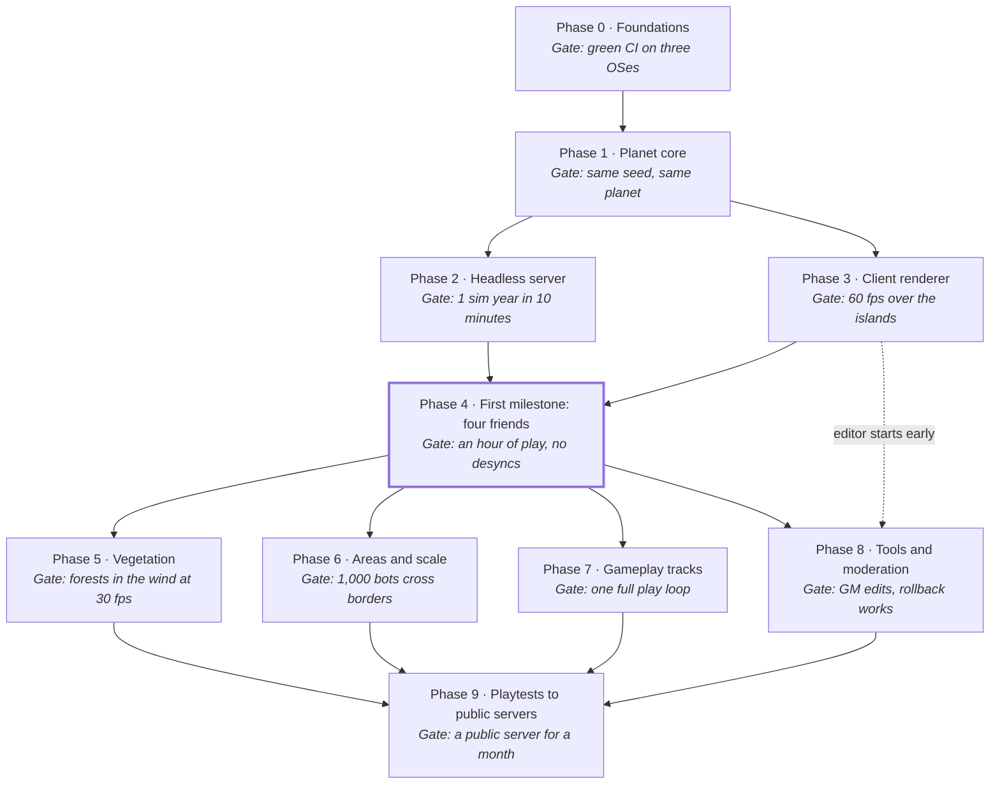

# Roadmap

Oct 10, 2026 · @Aaron Nixon

Start with Phase 0: a repo that builds and passes tests on Linux, Windows and macOS. Then build the planet library, whose first visible result is map images of the starting islands. Each phase ends at a gate the whole team can check. Near phases have detailed task lists; later ones stay coarse and get detail as we reach them.

## At a glance

Phases 0 and 1 are strictly in order. After that, server and client work split across the team until Phase 4. From there, vegetation, gameplay, scale and tools run side by side.

## Decide first

Five choices block Phase 0. Each one can be settled in an evening. The rest of the open questions are due only when their phase starts.

| Decision | Options | Needed by | Leaning or outcome |
| --- | --- | --- | --- |
| Repo host | GitHub, GitLab, Codeberg | Phase 0 | **Decided:** GitHub |
| Code license | MIT, Apache-2.0, MPL-2.0 | Phase 0 | **Decided:** MIT |
| Dependency management | vcpkg manifest, CPM.cmake, git submodules | Phase 0 | **Decided:** CPM.cmake, pinned versions |
| Unit-test framework | doctest, Catch2, GoogleTest | Phase 0 | **Decided:** Catch2 v3 |
| Compilers | Clang, GCC, MSVC, clang-cl, AppleClang | Phase 0 | **Decided:** Clang with libc++ first; GCC, MSVC and AppleClang in CI |
| Generator maths | Integer hashing, fixed-point, strict IEEE floats | Phase 1 | **Decided ([#7](https://github.com/SuperFes/HOG/issues/7)):** integer and fixed-point; floats only after the deterministic step |
| Change-store backend | SQLite, custom append-only log | Phase 1 | **Decided ([#8](https://github.com/SuperFes/HOG/issues/8)):** SQLite behind an interface, swappable for production |
| Development planet size | 500k, 2M or 10M population tier | Phase 1 | **Decided ([#9](https://github.com/SuperFes/HOG/issues/9)):** 500k (115 km radius); the radius stays a parameter |
| Entity system | EnTT, flecs | Phase 2 | **Decided ([#32](https://github.com/SuperFes/HOG/issues/32)):** flecs |
| Minimum-spec hardware | e.g. GTX 1060, Intel Iris Xe, Apple M1 | Phase 3 | Pick one real machine one of us owns |
| macOS Vulkan layer | KosmicKrisp, MoltenVK | Phase 3 | Support both and test against each |
| Network library | GameNetworkingSockets, QUIC with datagrams | Phase 4 | **Decided ([#83](https://github.com/SuperFes/HOG/issues/83)):** GameNetworkingSockets |
| Art direction | Three or four reference games | Phase 3 end | Open |
| Audio library | miniaudio, SoLoud, OpenAL Soft, SDL3 audio with our own mixer | Sound framework | Leaning miniaudio (MIT-0, one file, mixes hundreds of voices, its own spatialiser; output through SDL3 or the OS directly) |
| Death penalty, PvP default | See the plan's open questions | Phase 7 | Open |
| Generative AI in content | None, internal concept reference only | Before any content production | None in shipped assets |
| Content and art license | CC BY 4.0, CC BY-SA 4.0, proprietary | Phase 7 | Open |
| Age checks and minors | Legal review | Phase 9 | Official servers 18+ to start |

## Phase 0 — Foundations

This phase builds the repo and the rules every later line of code follows. It has no game in it yet.

**Gate:** a clean clone builds and passes tests with one command on all three operating systems. CI runs sanitizers on every push.

**Repo and process**

- [x] Create the repo with a README, LICENSE, .gitignore and .editorconfig
- [x] Export the plan doc to `docs/plan.md` and this roadmap to `docs/roadmap.md`
- [x] CONTRIBUTING.md with the code rules from the plan (no raw owning pointers, static dispatch by default, tests for everything)
- [x] Commit style: short conventional commits; pull requests reviewed by one other person
- [x] Issue labels (phase, track, bug, spike, decision) and one milestone per phase
- [x] Turn the Phase 0 and Phase 1 lists below into issues

**Build**

- [x] CMake 3.28+ with presets: debug, release, asan+ubsan, tsan
- [x] Ninja generator everywhere; ccache or sccache
- [x] C++23, warnings as errors in CI, `-Wall -Wextra -Wpedantic` and the `/W4` equivalent
- [x] Hardened standard library on: `_GLIBCXX_ASSERTIONS` and `_LIBCPP_HARDENING_MODE`, plus the MSVC checked-iterator equivalent
- [x] Dependency manager set up with pinned versions
- [x] .clang-format and .clang-tidy committed; format check in CI

**Continuous integration**

- [x] Linux: GCC and Clang
- [x] Windows: MSVC
- [x] macOS: AppleClang on Apple Silicon
- [x] Sanitizer job (address, undefined) on Linux
- [x] Thread-sanitizer job (nightly is fine)
- [x] clang-tidy job on changed files
- [ ] Test results and timings shown in the pull request

**Core library (`hog_core`)**

- [x] Generational handle and slot map: the replacement for pointers between objects
- [x] Error type built on `std::expected`; no exceptions across module boundaries
- [x] Assertions that stay on in release builds for invariants
- [x] Logging with categories and levels
- [x] Fixed-size math types: vectors, quaternions, double-precision world positions
- [x] Stable hashing (same output on every platform and compiler)
- [x] Clock and tick types that cannot be mixed up with each other
- [x] Job system: enkiTS behind `hog_jobs`
- [x] Benchmark harness (Catch2 BENCHMARK) next to the unit tests
- [x] Every item above has unit tests, and the slot map has a fuzz test

## Phase 1 — Planet core

This phase produces a pure library that turns a seed into a planet. It has no graphics; the map images it exports are the first thing we can show people.

**Gate:** the same seed produces bit-identical terrain on all three operating systems, which a golden test checks. The exported maps show a believable archipelago that the team signs off on.

**Cells and coordinates**

- [x] Cube-sphere cell address: face, level, x, y; packed into 64 bits
- [x] Neighbor lookup across face edges and corners, with exhaustive tests at low levels
- [x] Conversions between cell, direction on the unit sphere, and double-precision world position
- [x] Local tangent frame per cell, for physics and rendering
- [x] Planet parameters (radius, ocean fraction, seed) loaded from a config file, with radius computed from the population formula

**Deterministic generator**

- [x] Integer hash noise and fixed-point gradient noise
- [x] Golden-file tests: hashes of generated tiles checked into the repo and compared in CI on every platform
- [x] Continents and ocean basins at the target ocean fraction
- [x] Mountains and erosion pass (cheap approximation first)
- [x] Temperature and moisture bands, then biome assignment
- [x] Starting archipelago: 5–8 islands of 10–60 km², placed on the real planet
- [x] Geology strata and finite deposits per cell (stub values are fine)
- [x] Deep layers: crust thickness, mantle rock beneath it, and magma chambers under volcanic ground, so the whole volume can be dug through
- [x] Caves and tunnels: karst in wet limestone, lava tubes in basalt, sea caves in cliffs

**Change store**

- [x] Change record: cell, timestamp, author, kind, payload
- [x] Apply, replay and roll back changes on top of the seed
- [x] Storage backend behind an interface; SQLite first
- [x] Tests: replaying N random changes, then rolling back the last M, equals replaying N−M

**First tool: `hog-mapgen`**

- [x] Command-line tool that exports PNGs for the whole planet, any face, or one region
- [x] Layers: height, biome, temperature, moisture, deposits
- [x] Run it in CI and attach the images to pull requests that change the generator

## Phase 2 — Headless server

This phase builds a server that runs the world with nobody connected: time passes, weather moves, and animal populations rise and fall. It can be built in parallel with Phase 3.

**Gate:** one simulated year runs in under ten minutes on a desktop. Replaying from the same seed and inputs gives the same result. The debug viewer shows weather fronts and population changes that look plausible.

**Loop and entities**

- [x] Fixed-tick loop (20 Hz idle, up to 30 Hz in combat areas) with a game-time scale
- [x] Spike: EnTT against flecs, benchmarked with 100k entities and our access patterns; record the decision
- [x] Spatial index keyed by cube-sphere cell
- [x] Save and load: periodic snapshot plus the change log since then
- [x] Server config, structured logs, and metrics (tick time, entity counts); logged as JSON lines until a Prometheus endpoint

**Coarse simulation**

- [x] Calendar: day, night, seasons, and the sun's position from planet time
- [x] Weather grid: temperature, pressure, humidity, wind, cloud, precipitation
- [x] Weather moves with the wind, is shaped by terrain, and is checked against simple climate expectations
- [x] Wildlife: population per species per cell, with births, deaths, food and migration
- [x] Two or three test species (grazer, predator, scavenger) to prove the food chain
- [x] Recovery: emptied areas refill from their neighbours, wiped-out species return as founders after a while, and players can reintroduce animals
- [x] Ecology events (collapse, local extinction, return, overpopulation) against a long-run baseline, with kills attributed to hunters
- [x] Forest biomass per cell, with growth and a stub fire spread
- [x] Hydrology: rivers carve the land over geological time, with meandering channels, a water table, wetlands and mountain glaciers
- [x] Ocean currents: wind-driven gyres steered by the coasts, carrying sea temperature that feeds back into the weather
- [x] Sea state: waves raised by the wind over the time and distance it blows, travelling on as swell beyond it, sheltered behind land and steepened against the currents; kept by direction, so swells from several storms cross the same water; sent to players with the weather

**Debug viewer**

- [x] ImGui app that attaches to a running server and shows map overlays (weather, populations, biomass)
- [x] Time controls: pause, step, speed up
- [x] Click a cell to inspect its raw values
- [x] Rivers, lakes and the water table over the map, with a biome key

## Phase 3 — Client renderer

This phase builds a client that flies over the generated planet with a real sky. It runs in parallel with Phase 2 and reads the planet library directly, with no server yet.

**Gate:** a free-fly camera crosses the starting islands at 60 fps at 1080p on the chosen minimum-spec machine. It runs on Linux, Windows and macOS, and the horizon curves as it would on an Earth-sized planet.

**Platform and device**

- [x] SDL3 window and input; the renderer takes a `VkSurface` and never owns the window, so the Qt editor can host it later
- [x] Vulkan 1.3 through volk, with VMA for memory
- [ ] Spike: KosmicKrisp against MoltenVK on macOS
- [x] Validation layers on in debug builds, with errors failing CI smoke tests
- [x] GPU timing queries and a frame-time overlay

**Shaders and frame**

- [x] Slang compiled to SPIR-V at build time, with hot reload in debug builds
- [x] Simple render graph: passes, transient images, barriers handled automatically
- [x] Camera-relative rendering (doubles on the CPU, floats on the GPU)
- [x] Reverse-Z depth

**Planet**

- [x] Terrain chunks generated from the planet library on worker threads
- [x] Continuous LOD over the cube-sphere with no cracks at chunk borders
- [x] Faked Earth-sized curvature, blending to true curvature with altitude
- [x] Biome-driven materials (flat colors first, textures later)
- [x] Basic ocean surface
- [x] Sea drawn over ground at and just below sea level, so shorelines don't flicker
- [ ] The sea as water, not a sheet: everything under its surface seen through the water between, a wader's legs as much as the seabed (one water model, laid by the sea's pass over what depth says lies behind it)
- [ ] From under the sea: water along the whole view, darker the deeper; the sky only through the window overhead, the surface a mirror beyond it; a waterline across the screen where the eye straddles the surface
- [ ] Under the sea, felt: caustics on the bed and on what's in the water, light shafts, drifting motes, a wobble to the view
- [x] Waves: one wave function the client, the server and physics all evaluate alike (the planet's fixed trains, phased by the seed and the world's time, sized by the local spectrum, so everyone sees the same wave at the same place), the long waves moving the surface and fine chop in its shading, what's too fine to draw widening the sun's glint
- [x] Waves from the sea state: several systems at once, the local wind sea crossing swells from distant storms, so crests criss-cross and pile up where they meet, blended from cell to cell
- [ ] The surface's height under things standing in the sea, for their tint and for swimming
- [x] Foam: whitecaps where crests bunch past breaking, over as much of the sea as the wind breaks, ragged and streaked along it in a gale; the foam they leave lying in patches of lace, drifting with the current and the wind's drag
- [ ] Foam left where each crest broke, fading as it thins, and heaped where waves cross
- [ ] Waves at the shore: slowing and shortening in shallow water, turning to face the beach, steepening and breaking as surf, with foam and run-up
- [ ] Ripples and wakes where bodies cross the surface, and what's seen through it bent by the waves
- [x] Hillaire atmosphere and sun lighting driven by planet time
- [x] The sun as people see it: a glow and glare round its disc, rather than the bare disc a camera records

**Tests**

- [x] Headless render of fixed camera views, compared with reference images within a tolerance
- [x] Unit tests for the LOD selection and chunk-border stitching

## Phase 4 — First milestone: four friends on the islands

This phase joins the server and client. It ends at the first milestone: four of us walking the starting islands together on one server, with live weather.

**Gate:** four players on home connections, with up to 150 ms ping, walk, run, jump and chat for an hour. There are no desyncs or crashes, and everyone sees the same rain at the same time.

**Connection**

- [x] Spike: GameNetworkingSockets against QUIC with datagrams (and yojimbo); record the decision
- [x] Login service stub that issues signed connect tokens
- [x] One encrypted UDP connection with reliable, unreliable and ordered channels
- [x] Protocol versioning, so an old client gets a clear error message

**Replication**

- [x] Interest management by cell: each client receives only what is near it
- [x] Entity snapshots with delta compression against the last acknowledged state
- [x] Bandwidth and packet-loss counters in the debug overlay
- [x] Network simulator (latency, jitter, loss) in tests and in debug builds

**Movement**

- [x] Jolt physics in double precision; character controller on the sphere
- [x] Client prediction with server validation and correction
- [x] Smooth interpolation of other players
- [x] Placeholder avatars (capsules or a basic mannequin) with name tags
- [x] Third-person camera that turns about the character rather than about the eye

**World**

- [x] Server sends weather state; client renders basic clouds and rain
- [x] Text chat with the profanity filter on the client side (toggle per player)
- [x] Headless bot clients that wander the islands, for testing

**Hosting**

- [ ] One small cloud server or home server reachable by the team
- [ ] Crash dumps from client and server uploaded automatically to us

## Phase 5 — Vegetation

This phase covers the planet in procedurally generated plant life, grown from per-species rules and placed deterministically from the seed, shaped by the ecology the server already simulates: biome, forest biomass, moisture, fire history. It's client-heavy, runs in parallel with the phases after it, and is the first time the planet looks alive up close.

**Gate:** flying and walking over the islands shows grass fields, shrubland and mixed forests of visibly different species, holding frame rate on the minimum-spec iGPU. The same seed grows the same forest on every machine. Wind from the live weather visibly crosses a grass field in waves.

**Species rules**

- [x] Plant grammar: a species is a rule set (trunk habit, branch angles and counts per level, crown shape, leaf, needle or frond) that grows an individual deterministically from a seed (libs/flora: whorled levels, gnarl and rise, foliage as solid crossed fronds, meshed as low-poly tubes at baked detail levels)
- [x] First tree set, each with its own rules: a pine analogue (done: grown whole near the eye, stamped far off, one anchor set keying both; foliage is solid tapered fronds, thick at the trunk and thinning to the tip, needle-streaked in the shader), an oak analogue (done: a short trunk forking into gnarled limbs meshed as wood, a broad crown of full leaf fronds, gathered in groves among the pines by a share per biome, drawn in its own runs so each genus pays only its own vertex count; stamped far off as a lumpy round head), a maple analogue (done: a straight trunk under steep limbs, a denser oval crown that turns orange to scarlet before the oaks and is bare sooner, in smaller stands within the broadleaf groves, most of all in wetlands), a palm analogue (done: a bare stem leaning from its foot and curving back up, a crown of long arching fronds combed into leaflets, coconuts hung beneath once it bears; stamped far off as a starburst on a stem, in palm groves of its own); growth stages per species are species parameters scaled by age, for the server-run forest (environment-aware growth like space colonisation can slot in at flora::grow per species later)
- [x] Ground cover: tall and short grasses with far swaths, cattail reeds at waterlines, bushes in four silhouettes (floofy blobs, spiky rosettes, twiggy skeletons, low mats) mixed by biome
- [x] Age from the same seed: seedlings, saplings, mature and ancient trees from one rule set (each anchor carries an age, young at the woods' edges; flora::aged scales a species from sapling to old, exact in its prime; the forest bakes four stages and the stamps mirror them)
- [ ] Condition states: dead standing wood, half-fallen and felled trunks, fire-scorched survivors, insect- and animal-worn damage simulated without the animals (sound, failing, scorched, dead and charred done: each tree takes its condition from its own dice against its woods' shares, failing crowns thin and brown, the dead stand bare and snapped, weathered grey or burned black, survivors' trunks blackened; half-fallen, felled and worn still to come)
- [ ] Golden tests: the same seed grows the same plant, bit for bit, on every platform (hash baked, clang and gcc agree under -ffp-contract=off and libm-free trig; macOS unproven)

**Placement**

- [x] Placement from the sim: biome, forest biomass, moisture and the water table decide what grows where and how densely (each kind's niche in warmth and the ground's wetness, the water table wetting dry ground within the roots' reach; the forest sim's living, regrown, failing and standing dead shares per cell sent to players as woodlands and read between cells by every tree and the far woods, rebuilt in place as they change)
- [x] Deterministic per-cell scatter, so every client grows the same world with nothing sent over the network (grass by patch seed; trees and bushes as anchors sampled from the world itself on the CPU — one placement in libs/flora, bound to the ground at every terrain level, ready for the server to own as it owns the clouds)
- [ ] Placement reads the change store over the seed, so planted and cleared ground diverges — the hook farming (Phase 7) builds on (the tree anchors already rebuild their tiles on a changed cell)
- [x] Succession on burned or emptied cells from the forest sim's history: pioneer grass, then shrubs, then young forest among the burned trunks (the fire's black fades over a year or two; grass takes the ground where the trees are gone, shrubs where the dead have fallen, and the regrowth stands as many small stems, taking generations to be old growth)
- [ ] Seeds carried by birds and animals: burns heal inward from their living edges, faster where seed-eaters are plentiful, the light-seeded pioneers (birch, pine, berry shrubs) back first and the oaks last
- [x] A burned-in-the-past, regrowing forest somewhere on the starting islands to prove it (the dev server's new worlds begin with the first island burned eight years before)

**Life cycle and spread**

Borrowed from real species to make forests feel grown rather than scattered. A menu, not a contract: each mechanic is cheap once placement reads the sim, and we take the ones that earn their keep.

- [x] Climate niche per species: a temperature and moisture envelope decides each range — palm analogues frost-limited to warm coasts, pines climbing to a cold treeline, nothing growing where it shouldn't (each genus a range of mean annual temperature, thinning at its edges: palms on warm shores and in the tropics, pines to a cold treeline, giving way to broadleaves in the heat; and a range of the ground's wetness, the climate's moisture or a water table within the roots' reach: maples on wet ground, oaks off waterlogged ground, pines on the driest)
- [ ] Dispersal, pretended like the insect damage: winged seeds drift downwind of parents, bird-cached seeds jump gaps and march uphill (how oak and stone-pine analogues spread), water-borne seeds follow shores and rivers
- [ ] Allelopathy: a walnut-analogue poisons the soil around it and stands in a clearing of its own making; grass-suppressing crowns keep bare ground beneath them
- [ ] Serotiny: fire-sealed cones that open only in a burn, so burned ground reseeds first in the fire-pine analogue
- [ ] Mast years: a region's trees synchronize bumper seed crops, leaving dateable waves of same-aged saplings
- [ ] Shade tolerance orders succession: sun-loving pioneers first, shade-tolerant climax species growing up beneath them
- [ ] Nurse logs: seedlings rooted in rows on fallen trunks in wet forests
- [ ] Krummholz: trees at the treeline grow stunted and bent to the prevailing wind
- [ ] One endemic giant: a redwood-analogue growing only in a single fog-wet pocket of the planet

**Under the sea**

The sea is part of the same world, not a backdrop: its life is placed, grows and dies by the same rules as the land's, and its animals are populations in the same sim.

- [ ] Sea flora placed by the same anchors as the land's, by depth, the light reaching the bed, warmth and what the bed is: seagrass meadows on sandy shallows, kelp forests on cool rocky coasts, coral on warm reefs
- [ ] Rock and shore: barnacles, mussels and weed crusting rocks at the waterline, anemones and sponges deeper, wrack washed up along the beach
- [ ] Sways with the swell and the current rather than the wind
- [ ] Lives and dies as the land's does: kelp torn out by storms, coral bleached by hot water, beds regrowing from their edges
- [ ] Sea fauna as Phase 2's wildlife: plankton, grazers (urchins, small fish), shoals and their predators, crabs scavenging, with the balances real coasts show (urchins stripping kelp where their predators are gone)
- [ ] Tides, so the shore has a band that is sometimes sea and sometimes land (see Later: the moon and tides)

**Rendering**

- [x] Instanced rendering with LOD tiers: full geometry near (three baked details to 240 m), billboard impostors mid-range (crossed-quad stamps to 900 m), density and colour folded into the terrain far away (baked into the patches' vertices)
- [x] Grass as instanced blades and patches near the eye, fading into the ground material
- [x] Per-tier budgets checked on the minimum-spec iGPU, with counts in the frame overlay (Radeon 860M at 1600×900, deep woods: grown forest ~0.7 ms, stamps ~0.2 ms, after per-block 3D-distance and view-cone culling)

**Wind and weather**

- [x] Plants react to the weather grid's wind in the shader: still air sits still, light wind sways gently, storms hold plants bent in the wind's direction (grass bends, reeds stand stiff, bushes rustle, pine tops rock and hold over in storms)
- [x] Gusts travel as visible waves across grass fields
- [ ] High wind breaks branches and fells weak trees as sim events, so everyone sees the same deadfall

## Phase 6 — Areas and scale

This phase proves the world can be split across servers without players noticing. It starts with logical areas inside one process and moves to separate processes only once that works.

**Gate:** 1,000 bots wander across area borders for 24 hours. No entities are lost or duplicated, and handover never shows on a player's screen. Memory and tick time stay flat.

- [ ] Logical areas inside one process, each with its own tick and entity set
- [ ] Border mirroring: entities near a border are visible to both sides
- [ ] Handover of authority with no gap and no duplicate
- [ ] Dynamic borders that move toward crowds and away from empty land
- [ ] Coarse world simulation shared by all areas
- [ ] Split into separate processes with area-to-area messaging
- [ ] Far-field event digest: big distant events (fires, storms, dragons) sent to clients that could see them
- [ ] Load-test harness: thousands of bots, with scripted crowd scenarios such as everyone running to one town
- [ ] Dashboards for tick time, bandwidth per player and handovers per minute
- [ ] Bandwidth check against the plan's estimate of about 24 KB/s per player

## Phase 7 — Gameplay tracks

These tracks can start once Phase 4 works and can run side by side; four people means about four tracks at once. Each track is a tested library with its own debug views. Its gate is one small loop that is fun to play on the islands.

**Gate:** the islands support one full loop: gather, craft, fight, eat, rest and travel to the next island. NPCs there have jobs and ask for help.

**Scripting foundation (first, since other tracks use it)**

- [ ] Language-agnostic scripting interface; Squirrel 3.2 as the first binding
- [ ] Sandbox: instruction budget, memory cap, no file or network access
- [ ] Hot reload of scripts on a dev server

**Characters and clothing**

- [ ] Import MPFB2 CC0 base meshes and morphs; skeleton and retargeting
- [ ] Bake on appearance change, cached by appearance hash
- [ ] Animation: locomotion set, blending, foot IK on slopes
- [ ] Cage-wrap clothing layers 0–7; hiding covered surfaces
- [ ] Overlapping layers resolve to the outermost (outer clothing over inner, as water over ground at the shore), never flickering between them
- [ ] Fit ranges from body measurements; armor that is too big or small cannot be worn
- [ ] Plate armor attached to bones and driven by IK and constraints
- [ ] Character LOD tiers, with only the nearest N at full quality
- [ ] Character creator screen

**Combat**

- [ ] Action combat: melee swings, blocks and dodges, all resolved on the server
- [ ] Lag compensation from position history
- [ ] Damage, health and recovery; death with a placeholder penalty until it is decided

**Skills**

- [ ] Skill graph data model; effort tracked per use
- [ ] Skills combining into new skills
- [ ] First draft of the formula for level from total effort, tuned in a spreadsheet first

**Magic**

- [ ] Core model: gather, shape, contain, release
- [ ] Spell representation that every casting style compiles to
- [ ] One casting style end to end (speech or runes first)
- [ ] Containment failure: the fireball that bursts early
- [ ] Cost cap and sandbox for player-made spells

**Items and crafting**

- [ ] Every item has a maker; resource stats and experimentation
- [ ] Recipes with combined skills; no hard quality cap
- [ ] Study and reverse engineering (destructive analysis teaches more)
- [ ] Food and drink with short, fun buffs
- [ ] Player trading and a simple market

**NPCs**

- [ ] Needs, goal planning and jobs
- [ ] Statistical, individual and promoted tiers
- [ ] Quests generated from needs
- [ ] NPC master crafters with life goals

**Ecology and world change**

- [ ] Detailed creatures near players, coarse populations elsewhere
- [ ] Overpopulation that leads to cull quests; empty niches that refill or stay empty
- [ ] Apex succession (the dragon example)
- [ ] Consequences of wiping out wildlife, driven by ecology events: bounties, wardens, hunting bans, scarce-goods prices
- [ ] Planting and farming by players: sow, tend and harvest through the change store, growth riding the same climate and season rules as wild plants
- [ ] Quarries and mines as voxel volumes; finite deposits
- [ ] Building by players and NPCs, from tents and lean-tos to castles, walls and trails: posts sunk in the ground, foundations on soil or bedrock, and wind and snow that topple weak builds
- [ ] Structural integrity under Earth gravity for tunnels, buildings and bridges: span, load and material decide what holds; supports, cave-ins and sinkholes
- [ ] Upkeep as a job players and NPCs take; places nobody maintains crumble into ruins over the centuries
- [ ] Forest fire spread with weather; regrowth through succession

**Travel**

- [ ] Boats between islands
- [ ] Wagons and caravans as NPC jobs
- [ ] Wagon nap with the stand-in skeleton rider
- [ ] Player taxis with fare held in escrow

**Rendering, continued**

- [ ] Mid-distance hierarchical LOD and far-field impostors
  - Buildings in five steps:
    1. the full mesh;
    2. one or two simplified meshes, decimated at bake time;
    3. a shell with only the outer walls and roof;
    4. an octahedral impostor, rendered from many angles so it turns as you circle it;
    5. folded into the ground or the horizon panorama, as a few pixels of colour or a bump on the skyline.
  - Trees already have five tiers: three grown meshes, the stamps, and the canopy band in the ground. If the stamps prove costly between 240 and 900 m, add an impostor of a whole clump of trees.
- [ ] Horizon panorama relit every frame and refreshed as the player moves
- [x] Volumetric clouds that fill the sky's volume and can be flown through (raymarched, likely at reduced resolution)
- [x] Weather-driven visibility: haze as the air nears forming cloud, and fog lying in the low ground
- [x] Rain and snow seen from afar, falling in veils from the cloud base to the ground
- [ ] Showers within a weather cell: heavier cores and lighter gaps drifting with the wind, lumpier under storms, the same on every client, so a 6 km cell's mean rate becomes passing downpours and drizzle rather than one even rain
- [ ] Heavy rain looks heavy: bigger, faster drops and longer streaks, visibility closing in, and splashes on the ground, past today's cap of about 14 mm/h of drops
- [ ] The live weather's rain agrees with the planet's climate map, so biomes get the rain they were placed for (some forest cells now get little rain and dry out over the first years)
- [ ] Ground materials with roughness and wetness, wet where weather reaches and dry where it's sheltered (mud, rain on rocks)
- [x] Clouds hide the sun's glare by what they block of it: the marched clouds' opacity over the sun's disc while it's in the picture, the cloud's shadow over the eye (the same cloud along the sun's ray) when it isn't
- [x] Fog is cloud that has come down: the cloud base is 125 m a degree of dew-point spread, so it falls as the air cools at night, and where fog forms it comes down to the fog's top; fog is marched as cloud lying on the ground, lit, seen and hiding the sun as cloud does, in banks and wisps drifting with the wind, so walking through it patches pass by
- [ ] Fog thickest at the ground and pooled in hollows, rather than even under a top flat across a weather cell, and denser the further the air is past saturation
- [ ] Fog in the cloud's shadow map, so the ground under a fog bank is shaded by it rather than by the mist over the eye
- [ ] Lying snow with depth, in steps:
  1. Seen: the server already keeps lying snow per weather cell (snowfall, melt, sublimation; `sim::LandFields::snow`) but never sends it. Send it as the woods' fates are sent; the client spreads it into fine depth the same on every machine (more up high, less on steep or sunny slopes, drifted to the lee, thinner under trees), baked into the patch vertex's two spare bytes. The ground whitens by depth, thin snow letting grass through, deep snow burying grass and bushes.
  2. On top of things: snow on the upward faces of trees, bushes and rocks (snow on boughs joins the deciduous seasons); the snow's surface raises the ground and the physics ground with it, so feet sink in and slow down.
  3. Tracks: a trail map about players that feet stamp, pressing dents and turning shallow snow to mud, filling with new snow and fading as it melts; the server keeping them later, so animals can be tracked.
  4. Weight: the sim keeps the snow's density as powder settles to heavy wet snow, so its load is known: boughs bend and break under it, feeding the trees' fates, and later it loads roofs (see the buildings' wind and snow)
- [ ] Art direction pass once the references are chosen

## Phase 8 — Tools, scripting and moderation

Tools grow alongside the phases above, but this phase brings them together into what GMs and community server hosts need. The Qt editor can start any time after Phase 3, because the renderer already accepts any surface.

**Gate:** a GM edits the live dev server from the editor, and one of us hosts a community server from the docs alone. A test griefing incident is detected, restricted and rolled back.

**Editor (Qt 6 Widgets)**

- [ ] Editor shell hosting the Vulkan viewport
- [ ] Authored layer: place and edit towns, roads, landmarks and NPC homes on top of the generated base
- [ ] Asset browser and Blender import pipeline
- [ ] Live GM editing on a dev server, with every edit going into the change store
- [ ] Approval queue for freehand paint and decals

**Scripting**

- [ ] Script API documentation generated from the bindings
- [ ] Second language binding behind the same interface (WASM through Wasmtime or WAMR)
- [ ] Per-server mod loading

**Moderation**

- [ ] Per-server ruleset file: PvE or PvEvP, chat rules, age setting
- [ ] Player reports with context captured automatically
- [ ] Self-hosted toxicity classifier for chat
- [ ] Behavioral automod (for example, a high-level player repeatedly attacking new players)
- [ ] Escalation: flag, restrict, temporary ban, review, permanent ban
- [ ] Rollback by author and time range from the change store
- [ ] GM tools: teleport, observe invisibly, mute, inspect a player's history

**Hosting**

- [ ] Server packages (container image and plain binaries) with a setup guide
- [ ] Server browser listing for community servers

## Phase 9 — Playtests to public servers

This phase widens the audience in steps, and each step needs the one before it to hold.

**Gate:** a public server runs for a month with community moderators. Crashes, exploits and griefing are handled by the tools rather than by us staying up at night.

- [ ] Friends alpha: invite-only, about 20 players, with a feedback channel and weekly builds
- [ ] Telemetry the players opt into: crashes, performance, where people go and quit
- [ ] Legal review of age checks and minors before any public server
- [ ] Community server release: packages, docs and the ruleset file
- [ ] Official server, 18+ to start
- [ ] Launcher and auto-updater for all three operating systems
- [ ] Android: start only after the desktop client is stable

## Later

Work we've agreed we want but have parked, so it isn't lost between phases. Each item names where it plugs in. When an item's phase comes up, it moves into that phase's task list.

**Plant life and death**

Builds on Phase 5's condition states. The server owns every tree's record, as it owns the clouds. The anchors are the per-cell registry that record attaches to.

- [ ] A server-owned record per tree: species, age, condition, and when it changed. Unchanged trees stay implied by the seed, so only the trees that changed are stored or sent.
- [ ] Ageing on the server's clock: seedlings grow up, mature trees grow old, old trees die. Growth rate follows the cell's moisture, light and crowding.
- [ ] Dying and dead plants: thinning and browning crowns, then a bare standing snag, then a fall. Bushes and grass brown off and die back the same way. (Crowns thinning and browning and bare snags done, from the forest sim's shares. Once fallen, a dead tree leaves the tree records to become a deadwood game object of its own that decays, scattering natural deadwood through the woods.)
- [ ] Bushes that live and die with no record each: a shrub layer in the forest sim, cell by cell like the trees' shares, and each bush's fate rolled against it, so bushes sprout, grow, thin and die where they stand. A record per bush would cost gigabytes (about 2 billion on the development planet); only bushes players cut or trample get one.
- [ ] Tumbleweeds: dead bushes of a tumbleweed species in dry biomes break off as their fate says, roll with the ground wind as small server objects (about 32 B each, only while moving), and settle and decay where they lodge
- [ ] Felled trees: cut by players or blown down by storms. The trunk falls as a physics body along the cut or the wind, lands where everyone sees it land, and leaves a stump.
- [ ] Deadwood that decays over seasons: fallen logs go mossy and soften, then sink into the forest floor. Nurse logs come from here.
- [ ] Regrowth: suckers and coppice shoots from stumps of the species that do it, and seedlings filling gaps, as the succession rules decide.
- [ ] Fire's marks: scorched bark on survivors, burned snags, ash ground that greens over again.
- [ ] Lightning strikes, disease and pest outbreaks as rare sim events that kill trees in patches.
- [ ] Seasons for deciduous species: leaf-out, autumn colour, bare winter crowns, snow resting on boughs (timing, colour, leaf fall and bare crowns done: each broadleaf keys off the day's length at the eye, so autumn comes sooner further from the equator and never in the tropics). Each tree turns on its own date, set by its seed and age and the same every year, so one tree is already red while its neighbours are still green. Autumn crowns mix colours. Leaves fall as wind-blown GPU particles near the eye, and the ground under the trees is tinted with them.
- [ ] Harvest yields from the same records: wood by species and age, bark, resin, fruit and seed. Crafting (Phase 7) reads them.
- [ ] Tree changes replicated to clients by cell, as weather is. The anchor tiles rebuild from them (`TreeAnchors::changed`, not yet wired to world changes).

**The moon and tides**

Plugs into the calendar (Phase 2) and the sea state. The moon is a body on its own orbit, so everything below is a function of the world's time, the same for everyone with nothing sent.

- [ ] A moon on a real orbit, tilted to the planet's, so its rising, its height and its eclipses come where and when the orbit says
- [ ] Phases from where the sun lies: the disc lit from the sun's side, new to full and back, the dark side faintly lit by the planet's own light, a textured face (CC0 or procedural)
- [ ] Moonlight: the night lit by it, bright at full and dark at new, the sky scattering it as the atmosphere scatters the sun's, and a moon road glittering across the waves
- [ ] Solar eclipses: the disc covering the sun, the corona and the diamond ring at the edges of totality, the light dimming and the sky darkening to dusk all round, the moon's shadow racing across the land and the clouds
- [ ] Lunar eclipses: the moon turned copper by sunlight bent through the planet's air, its colour from the same atmosphere tables the sky is drawn with
- [ ] Tides raised by the moon and the sun: springs at new and full moon, neaps between; the sea level everywhere follows them, a tidal range larger on wide shelves and in funnelling bays, and tidal currents through narrows
- [ ] Surfing: breaking waves the physics rides, because it evaluates the same wave function the surface is drawn with; a board, paddling out, catching and riding a face, wiping out

**Sound**

Can start any time after Phase 4. Sound is driven by the same world state that's drawn, so what's heard matches what's seen: the wave function, the sea's breaking and swash, the weather, and the ecology's populations. None of it is sent; each client works it out where the listener stands.

- [ ] Framework: one audio thread mixing hundreds of voices into one stream, fed by lock-free commands from the game thread; virtual voices ranked by how loud each would be, so only the loudest few dozen are mixed; buses for the world, ambience, interface and music, each with its own volume
- [ ] Placing sounds: direction and distance from the listener on the bent planet, air absorbing the highs with distance, and wind carrying sound downwind; HRTF on headphones later (Steam Audio, Apache-2.0, if ours isn't enough)
- [ ] Layered ambience beds: crossfaded loops picked by biome, weather, time of day and the listener's height, so the forest, the open sea and a storm each have their own bed
- [ ] The sea as it's drawn: a far roar from how much surf breaks within a kilometre, darker with distance; nearby breaking crests and whitecaps as single crashes where and when the wave function breaks them; the swash's hiss rising and falling with each surge, and the fizz of foam left as it draws back; a lake's lap against the shore from its fetch; all read from the CPU wave function, never the GPU
- [ ] Wind: gusting with the weather, louder through trees by how wooded the ground is and how much they sway, whistling over ridges
- [ ] Rain and snow: on water, on leaves, on rock and on whatever's overhead, thunder delayed by the flash's distance
- [ ] Hulls in the water: slaps where the wave function strikes the hull faster than it rides, a bow wave's rush with speed, creaking under load (with boats in Phase 7)
- [ ] Birds and animals: calls from the ecology's populations round the listener, a dawn chorus and dusk, seabirds over the shore, each species' calls placed in the trees and the sky; silence where nothing lives
- [ ] Footsteps and bodies: by the ground's material and wetness, wading and swimming splashes from the water's height at the feet

**Vegetation engineering**

- [x] Bushes onto CPU anchors like the trees, so they too stay put at every terrain level and the server can own them: `libs/flora` places each from the world and the fates at its own spot, near another biome rolling which one it grows as. Tree and bush tiles build on the job pool, off the frame.
- [ ] Anchor tiles built off the main thread, if building them ever shows in frame times
- [x] Forest beyond the stamps' 900 m folded into the ground as density and colour, so woods don't end at a line seen from the air (flora's woodland averaged per patch vertex, crowned and turning with the year in the ground's shader; ~free on the 860M)
- [ ] Solid leaf masses ("tree haircut"): crowns modelled as clumped blobs and lit like the clouds, textured in the tree's current leaf colours, and a billboard far off. Bushes get the same treatment, replacing their billboards.
- [ ] Needle and bark textures, CC0 or procedural, to replace the shader's streaks if they earn it
- [ ] Richer growth per species at `flora::grow`, such as space colonisation for broadleaf crowns that grow toward light and around their neighbours

**Parked by choice**

- [ ] Phase 4's remote server and automatic crash-dump upload. Until then, friends connect to a dev machine directly.
